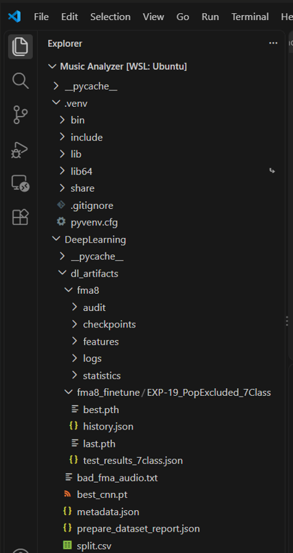
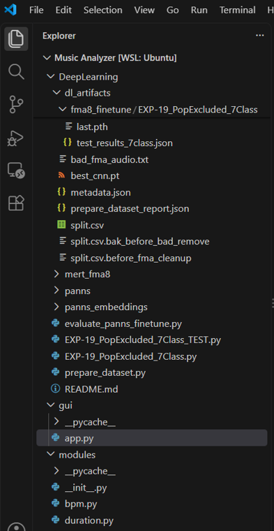
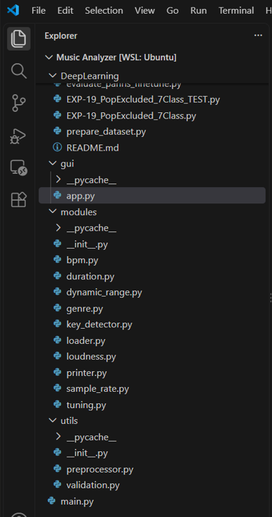
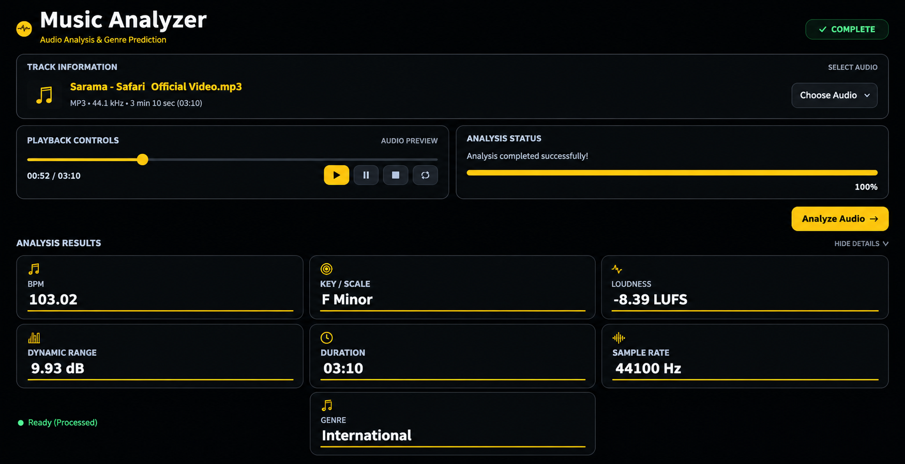

# 🎵 Music Analyzer

**A Python-based desktop application combining audio signal processing and deep learning-based music genre classification.**

Music Analyzer analyses WAV and MP3 audio files and displays their musical and technical characteristics through a single graphical user interface.

## ✨ Features

- **BPM Detection** – Estimates the tempo of an audio track.
- **Key & Scale Detection** – Identifies the estimated musical key and scale.
- **Loudness Analysis** – Measures integrated loudness in LUFS.
- **Dynamic Range Analysis** – Estimates the dynamic range of audio.
- **Duration Detection** – Extracts audio duration.
- **Sample Rate Detection** – Identifies the audio sample rate.
- **Genre Classification** – Predicts music genres using a deep learning model.
- **Audio Playback** – Allows users to play selected audio files.
- **Input Validation** – Checks invalid, empty, silent and unsupported audio files.

## 🧠 Deep Learning – Genre Classification

The genre classification module uses **PANNs Cnn14 with Transfer Learning**, adapted using the FMA-small dataset.

The final model, **EXP-19**, classifies music into seven genres:

Electronic · Experimental · Folk · Hip-Hop · Instrumental · International · Rock

### Model Evaluation

| Metric | Result |
|---|---:|
| Test Accuracy | 74.52% |
| Macro Precision | 74.72% |
| Macro Recall | 74.50% |
| Macro F1-Score | 74.07% |
| Test Samples | 1,048 |

The best checkpoint was selected using validation Macro F1-score. The test set was kept separate for final evaluation.

## 🛠️ Technologies Used

- **Programming Language:** Python
- **GUI:** CustomTkinter
- **Audio Processing:** Essentia, Librosa, SoundFile, Mutagen, pyloudnorm, SciPy
- **Deep Learning:** PyTorch, PANNs Cnn14
- **Dataset:** FMA-small

## 📂 Project Structure

The following screenshots show the project's original development folder structure and the organization of its main components.

## ⚙️ How It Works

1. Select a WAV or MP3 audio file.
2. The application validates the selected audio.
3. Audio processing modules extract the musical and technical characteristics.
4. The trained deep learning model predicts the music genre.
5. All results are displayed through the graphical interface.

## 🚀 Installation & Usage

Installation instructions, required dependencies, environment setup, PANNs configuration and application execution steps are provided in the project documentation.

The Deep Learning folder contains the training scripts used for the genre classification model. Refer to the documentation for the required PANNs setup and training procedure.

## 📸 Application Interface

The Music Analyzer desktop application features a dark interface with amber highlights, audio playback controls and an integrated analysis results panel.

## 👨‍💻 Developers

**Jitesh Kumar Yadav**

**Ranjeet Verma**

B.Sc. Data Science & Artificial Intelligence

---

*Music Analyzer – Combining Audio Signal Processing, Transfer Learning and Deep Learning.*
